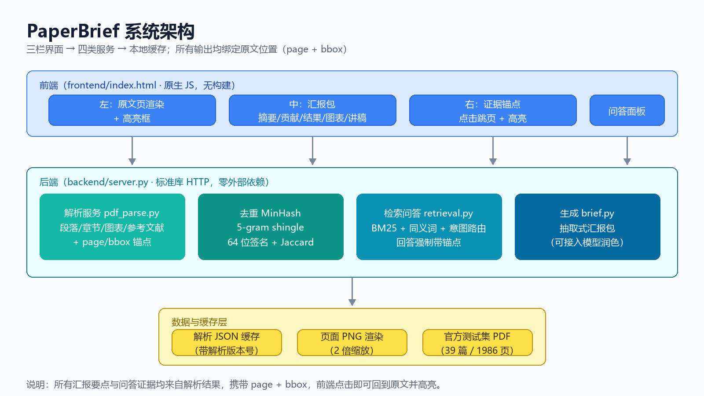

# PaperBrief · 论文汇报包助手

> 一个「每条结论都能点回原文」的科研阅读 Agent。
> 第九届传智杯 AI 大模型创新应用挑战赛 · 科研小助手 Agent 命题 · 个人赛

**代码仓库**：<https://github.com/Skr433/paperbrief>
**在线演示**：<http://1.14.98.248/>（腾讯云，长期在线）
**演示视频**：<https://www.bilibili.com/video/BV18XWB69ERU/>（6:01 / 1080p）

---

## 参赛信息

- 赛道：第九届传智杯 · 科研小助手 Agent（10040）
- 形式：个人赛
- 参赛人：史良宇 · 成都信息工程大学 · 学号 2025125112 · UID 2124770
- 在线演示：<http://1.14.98.248/>（无需登录）
- 技术文档：`04_资料/技术文档_v2_20261113121734.pdf`（26 页）

---

## 1. 解决什么问题

读一篇英文论文、并在组会上讲清楚，通常要 2 小时：翻摘要、找方法、抠实验数字、截图、做 PPT。
用通用 AI 总结，最大的问题是**没法核实它说的是不是论文里写的**。

PaperBrief 的做法：**先解析出带坐标的文档结构，再基于结构生成材料，材料里的每条结论都带页码锚点**。
点一下 `p.7`，左侧原文跳到第 7 页并高亮对应段落——**说错一眼就能看出来**。



---

## 2. 功能（对应命题 1.1–1.6）

| 命题章节 | 实现 | 状态 |
| --- | --- | --- |
| 1.1 PDF 管理与解析 | 标题/作者（含机构）/章节树/图表/参考文献/公式；**语义去重**（MinHash，v1 与 v7 相似度 73% 即提示保留新版） | ✅ |
| 1.2 单篇问答 | **混合检索**（BM25 召回 + bge-small 向量重排）+ 意图路由；DeepSeek 生成答案，**强制带 `[p.X]` 页码**；作者/参考文献走结构化抽取 | ✅ |
| 1.2 多篇对比 | 两篇论文分别检索 → 生成对比结论，分别标注 `[A p.X]` / `[B p.Y]`，锚点可跳对应论文 | ✅ |
| 1.3 阅读与翻译 | 页面渲染、章节树、**引用双向跳转**（正文 [n] ↔ 参考文献）、整页翻译/点按翻译（段落级缓存） | ✅ |
| 1.4 arXiv 追踪推荐 | 按当前论文关键词找近 18 个月新论文、关键词搜索、有代码标记、LLM 相关度排序、中文标题摘要 | 🟡（自动下载与点赞/踩未做） |
| 1.5 引文图谱与综述 | 参考文献 → Crossref 元数据 → 引文网络（力导向/主题聚类/缩放拖拽）+ PageRank；DeepSeek 生成中文综述 | ✅ |
| 1.6 写作助手 | 汇报包（摘要/贡献/结果/图表/术语/讲稿）、AI 摘要、Markdown 导出、**CSV → 图表 + 图注 + 可复现脚本** | ✅ |

**降级设计**：DeepSeek 超时/欠费/无 key 时，问答自动回退抽取式答案，翻译保留原文，页面不崩。

---

## 3. 评测结果

官方测试集（39 篇 + 1 篇上传）全量复测（2026-11-13，v0.14.65）：
- **解析 40/40 成功，0 个 500**；总耗时 32.5s（缓存命中）
- 官方 9 题：**6 正确 / 3 部分 / 0 错误**（缺 GPT-2 原论文，属数据限制）
- 线上 31 项回归 **31/31 PASS**（解析 / 问答 / 模块 / 边界）
- 20 题对照实验：无依据数字 **65% → 10% → 0%**（纯 LLM / RAG / 本系统）

统一数字出处：**[docs/evaluation-2026-11-08.md](docs/evaluation-2026-11-08.md)** 与 `04_资料/评测_1108/回归_v0.14.61.md`。

性能：问答 1.0–1.8s（缓存更快）；多篇对比 3.1–5.6s；翻译同页二次 0.01s；图谱 21 节点、综述 3.4s。

复现方式：

```bash
python scripts/regression.py --base http://1.14.98.248   # 9 题回归表
python scripts/evaluate.py   --base http://1.14.98.248   # 解析质量 + 检索命中率 + 延迟
```

---

## 4. 快速开始

```bash
pip install -r requirements.txt        # 唯一依赖：PyMuPDF（其余全部标准库）
python backend/server.py               # 默认 8000 端口
# 打开 http://127.0.0.1:8000
```

Windows 可双击 `start.bat`。

**接入大模型**（可选，不配置也能跑抽取式）：

```bash
export DEEPSEEK_API_KEY=sk-xxxx        # Linux/macOS
$env:DEEPSEEK_API_KEY="sk-xxxx"        # PowerShell
```

**准备论文**：把 PDF 放进 `pdf/` 目录，或设置 `PAPERBRIEF_PDF_DIR=/path/to/pdf`。

### 本地模型（离线，可选）

同一套代码支持切换到本机 Ollama，完全不依赖云 API：

```bash
# 1) 安装 Ollama 后导入 GGUF 模型（国内从 hf-mirror 下载，不依赖官方仓库）
ollama create qwen2.5-3b-local -f Modelfile
# 2) 启动本地版（Windows 双击 start_local_llm.bat）
#    等价环境变量：OLLAMA_BASE_URL=http://127.0.0.1:11434  OLLAMA_MODEL=qwen2.5-3b-local
python backend/server.py
# 3) 打开 http://127.0.0.1:8010
```

实测（RX 7700S 8GB）：qwen2.5-3b q4 推理 **79 tok/s**，单问题 **0.6–1.4 秒**；简单事实题正确，复杂提取题质量弱于云端 DeepSeek，定位为**离线降级方案**。

---

## 5. 目录结构

```
paperbrief/
├─ backend/
│  ├─ server.py      # HTTP 路由 + 静态服务（标准库 ThreadingHTTPServer）
│  ├─ pdf_parse.py   # PDF → 段落/章节/图表/参考文献 + bbox 坐标
│  ├─ retrieval.py   # BM25 + 同义/跨语言扩展 + 事实证据包，回答必带锚点
│  ├─ brief.py       # 汇报包生成 + Markdown 导出
│  ├─ llm.py         # DeepSeek / Ollama 双后端，失败自动降级
│  ├─ graph.py       # 引文图谱（Crossref + PageRank + 主题聚类）
│  ├─ chart.py       # CSV → SVG 图表（折线/柱状/散点）+ 图注
│  └─ arxiv.py       # arXiv 搜索/推荐 + Crossref 出版状态
├─ frontend/index.html   # 单文件前端（原生 JS，无构建）
├─ scripts/
│  ├─ regression.py  # 官方 9 题回归，输出 Markdown 表
│  ├─ evaluate.py    # 解析质量 + 检索命中率 + 延迟
│  └─ smoke_test.py  # 离线冒烟
├─ deploy.sh         # Ubuntu 一键部署（systemd + Nginx）
├─ AGENTS.md         # 开发约定与已知坑
└─ data/             # 运行时缓存（不入库）
```

---

## 6. 部署

买服务器 → 放行 80 → 传包 → `sudo bash deploy.sh` → 验证，完整步骤与常见问题见 **[docs/deploy.md](docs/deploy.md)**（部署命令唯一出处）。

脚本会：装依赖 → 建 venv → 写 systemd unit → 配 Nginx 反代 → 健康检查；密钥只放 `/opt/paperbrief/.env`，不入库。

---

## 7. 已知限制（如实说明）

1. 官方测试集**缺 GPT-2 原论文**，GPT-1 原文未给参数量/上下文长度 → GPT 多篇题只能部分回答。
2. 扫描件（无文本层）未接 OCR，解析结果为 0 段落。
3. 服务器 2G 内存：混合检索采用「BM25 召回前 20 段 + bge-small 向量重排」，不做全库向量索引（首次编码约 0.5s，之后走缓存）。
4. OpenAlex / Semantic Scholar 对机房 IP 限流（429），引文数据改用 Crossref + 标题相似关联。
5. 1.4 的「论文自动下载」与「点赞/踩」未实现；
6. arXiv 从国内机房访问不稳定（偶发超时），已做重试 + 结果缓存 + 友好提示，演示前建议先点一次预热缓存。

---

## 8. 技术选型说明

- **为什么用标准库 HTTP**：评审 `git clone` 后 `python backend/server.py` 即可跑，无需装框架。
- **为什么图表手写 SVG**：2G 服务器装 matplotlib 不划算（字体/内存），且输出即矢量。
- **为什么混合检索只重排不建全库索引**：267–1200 段全量编码要 3–15s，会拖垮首次解析；只对 BM25 前 20 段重排，兼顾精度与延迟。
- **为什么"强制锚点"**：把"抗幻觉"从提示词承诺变成产品约束——没有页码的回答不显示。
- **为什么保留降级**：评审现场网络/额度不可控，任何外部依赖失败都不能让演示崩。

---

## 9. 许可

竞赛参赛作品，仅用于赛事评审与学习交流。
